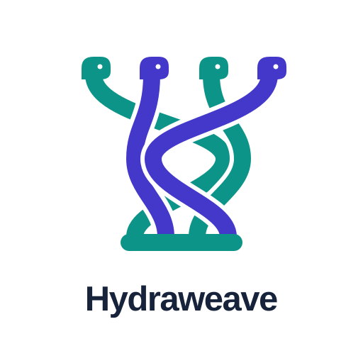
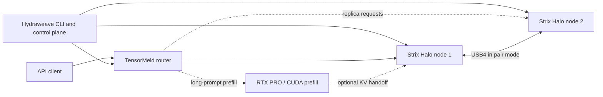

<p align="center">
  <picture>
    <source media="(prefers-color-scheme: dark)" srcset="docs/assets/hydraweave-logo-dark.svg">
    <source media="(prefers-color-scheme: light)" srcset="docs/assets/hydraweave-logo.svg">
    
  </picture>
</p>

# Hydraweave

Many heads — nodes and GPUs — weaving one inference. Hydraweave places, schedules and serves LLM inference across several devices.

**Renamed from hyperloom.** Existing imports and the `hyperloom` command remain available; old environment variables and config/state paths are read as fallbacks. See the [migration note](docs/rename.md).

The public-only [Qwen starter](docs/model-downloads.md#public-only-starter) provisions its model from
pinned public GGUF parts: **starter: correct but not the tuned speed**. Hosting derived artifacts for
the tuned presets remains a [user decision](docs/hosting-options.md).

**One control plane for AI inference across different machines.** Hydraweave brings a Windows workstation with an NVIDIA GPU and AMD Strix Halo Linux mini-PCs into one explicitly configured cluster. It installs pinned components, manages their lifecycle, starts a router, and gives operators a unified view of nodes, links, logs, and performance.

> [!IMPORTANT]
> **Development status — not production-ready (2026-10-25 evening):** deployment and the DeepSeek pair have passed hardware acceptance. The local portal has a hardware start/stop smoke test, with crash-cleanup acceptance still open. RTX prefill build, standalone exactness and capped placement are validated; the complete pair + RTX placement run remains pending. Recipe orchestration, the expanded portal and context-aware placement are pending integration.

## What problem does it solve?

Large models, fast prefill, and high-throughput decoding may need different hardware. Running each engine manually across multiple machines means coordinating versions, network endpoints, model files, launches, GPU reservations, and failures yourself.

Hydraweave is the **integration and orchestration layer**, not another inference engine. It connects:

| Component | Responsibility |
|---|---|
| [TensorMeld](https://github.com/hyukudan/tensormeld) | Request routing, replica balancing, placement and benchmarking |
| [Strix Halo Engine](https://github.com/hyukudan/strix-halo-engine-lab) | AMD HIP decode workers and an NVIDIA CUDA prefill service |
| [Strix Trellis](https://github.com/hyukudan/strix-trellis) | Quantized dense kernels used by supported engine profiles |
| **Hydraweave** | Reproducible installs, configuration, machine checks, safe process lifecycle, CLI and local portal |

**Accepted deployments:** two Strix Halo nodes can serve Qwen replicas or run DeepSeek as a pair over USB4. Optional long-prompt prefill on an RTX PRO 6000 (96 GB, Windows WDDM) has standalone validation; end-to-end acceptance through Hydraweave is still pending. Per-preset engine adapters also cover MiniMax; see [pins and launch constraints](docs/adapters.md).

## How it fits together



The CLI uses a versioned cluster configuration and pinned releases. Machines are added explicitly via SSH with host-key verification; GPU jobs run under supervised leases. The router can run locally or on a linked machine. See [architecture and lifecycle details](docs/README-technical.md#architecture).

Hydraweave reports the installed package version, or a Git describe version when run from a checkout. The Nodes view marks discovered agents whose release differs from the controller; local development suffixes are ignored. See [version and node compatibility](docs/install.md#versions-and-node-compatibility).

## Getting started

### Linux

```sh
curl -fsSL https://github.com/hyukudan/hydraweave/releases/latest/download/install.sh | sh
```

**No GitHub release exists yet.** Releases are produced by pushing a `v*` tag matching the package
version; the command above becomes available after the first release. Until then, use the
[source checkout instructions](docs/install.md#from-a-git-checkout).

The installer requires Python 3.11+ (3.10+ with `--node`) with `venv`, verifies the release wheel against `SHA256SUMS`,
and installs under `~/.local/share/hydraweave/venvs/<version>` with a `~/.local/bin/hydraweave` shim.
It needs no root access. Use `sh install.sh --node` for node extras and an agent shim, or
`--version v0.1.0`, `--prefix <directory>`, `--dry-run`, and `--from-file <wheel>` as needed.
See [Installation](docs/install.md) for offline installs and ROCm discovery.

### Windows

The Windows helper requires Python 3.11+, Git and OpenSSH. In PowerShell:

```powershell
git clone https://github.com/hyukudan/hydraweave.git
cd hydraweave
git submodule update --init --depth 1 third_party/tensormeld
.\windows\install.ps1
hloom --help
```

### Open the control center

After installing the Python package, run `hydraweave ui`. **Home** can create a new workspace, then guide you
through adding nodes, verifying SSH identities, choosing an engine profile and installing its pinned components.
**Engine settings** provides editable controls and launch previews; **Components** checks upstream revisions and
downloads sources without changing a running release. Existing tools remain available under advanced navigation.

```sh
hydraweave ui --config ~/.config/hydraweave/cluster.json
```

The controller can run on Windows or Linux. It is independent of the engine's rank 0, and the router can run on
the controller or a supported Linux node. See [the control-center guide](docs/control-center.md) for first-run
setup, controller placement, updates and the distinction between lab leases and persistent service mode.

These host-side improvements do not requalify newer engine/driver revisions on GPU hardware. Upstream source,
staged source and an installed/active profile are shown separately.

Then use [the sample cluster configuration](examples/cluster.example.json) to describe your machines, model assets and profiles:

```powershell
hloom config validate "$env:APPDATA\hydraweave\cluster.json"
hloom doctor node1
hloom doctor node2
hloom render qwen-replicas
```

**Hardware acceptance covers phases 1a and 2, with a partial portal smoke test;** see the acceptance documents. The staged install/start/stop workflow and its constraints are explained in [the detailed quick start](docs/README-technical.md#quick-start). Not every documented future option is implemented: notably `--plan` and `--allow-partial` are planned.

## Current status

| Phase | Status |
|---|---|
| 0 — configuration, rendering and local router control | Complete |
| 1a — deployment and node supervision | Accepted on real hardware (2026-10-23, Qwen replicas) |
| 1b — local monitoring portal | Implemented on main; real node data and Qwen start/stop exercised; portal-exit cleanup test still open |
| 2 — validated cluster profiles and operational workflows | Accepted on real hardware (2026-10-23/24, DeepSeek pair) |
| 3 — optional RTX prefill and heterogeneous inference extensions | 3a in progress: CUDA build and prefill service on the RTX PRO accepted (fidelity gate equal to the exact reference at 512 / 2K / 8K / 32K); pair + RTX placement through `up` pending; optional operator gate before the device is touched |
| 4 — operational extensions | Installation/release tooling, qualified knobs, diagnostics, Prometheus export and optional non-lab service mode implemented; discovery/pairing and Windows workers remain later work |

Linux users can run the portal as a user service with `hydraweave service install`; use `hydraweave-node pair`
to reissue an expired node pairing code.

These statuses describe **Hydraweave integration work**, not the maturity of individual underlying engines. See the [full roadmap and acceptance criteria](docs/SPEC.md) and the acceptance records for [Phase 1a](docs/acceptance-1a.md), [Phase 2](docs/acceptance-2.md) and [Phase 3a](docs/acceptance-3a.md).

### Measured integration results

Hydraweave versus the same engine launched by the lab, on two Strix Halo nodes (DeepSeek uses USB4). Token identity is relative to the named quantized profile. Historical component-only results remain in the [technical overview](docs/README-technical.md#performance).

| Profile / conditions | Measured result | Evidence |
|---|---|---|
| Qwen3.8-Flash-Next, UD-Q4_K_XL + Q8_0 MTP, context 12,288; 8 greedy prompts, up to 64 output tokens | 478 tokens identical across both launchers | [2026-10-23 acceptance](docs/acceptance-1a.md) |
| DeepSeek V4.1 Flash, Q2 experts + 6.5-bit overlay and trellis mix-B, context 4,096; 8 fixed prompts × 192 output tokens, C1 / C4 | Full Hydraweave start: 36.5 / 55.9 tok/s aggregate; separate greedy gate: 290 identical tokens | [2026-10-23/24 acceptance](docs/acceptance-2.md) |
| DeepSeek updated preset, same base quantization with trellis attention/dense sites enabled, context 4,096; 8 fixed prompts × 192 output tokens, C1 / C4 | 39.4 / 64.7 tok/s aggregate; separate greedy gate: 284 tokens identical in all three A/B/A arms | [2026-10-24 adapter check](docs/adapters.md#hardware-check-ds41-pair-w5-2026-10-24) |

The updated-preset comparison uses engine `cab238d6` + trellis `c95a1695`: Hydraweave versus a manual build of the same commits. DeepSeek prompt lengths/categories are not recorded in the acceptance summaries. These integration runs have no reported hardware ceiling.

Pending integration follows these decisions:

| Work | Design / current boundary |
|---|---|
| Recipes and portal deployment | Shared CLI validation, immutable launch-input snapshots and request-time resource checks. Router pin update and hardware qualification remain prerequisites; built-in recipes are not accepted deployments. |
| Context-aware placement | The operator chooses context and a speed/context trade-off; the validated plan becomes launch input. Predictions are labelled; model/context/engine/driver/budget changes invalidate it. This extends the current [capped prefill planner](docs/vramplan.md) and is pending implementation. |
| Budgets and probes | Every GPU needs its own grant; pinned/pageable host budgets are separate. Probes are explicit and receipts cached; passive planning runs no GPU work and never adds another GPU automatically. |
| Expanded portal | Telemetry history, fleet/health views, benchmarks and operations are implemented in pending branch work, awaiting integration and acceptance. |

## Documentation

| Guide | What you'll find |
|---|---|
| [Installation](docs/install.md) | From-scratch setup, prerequisites, releases, upgrades and rollback |
| [Technical overview](docs/README-technical.md) | Original detailed README: architecture, requests, leases, builds, component pins, measurements and security |
| [System specification and roadmap](docs/SPEC.md) | Planned phases, design constraints and acceptance gates |
| [Adapters](docs/adapters.md) | Interfaces to the underlying engines and router |
| [Model assets](docs/assets.md) and [downloads](docs/model-downloads.md) | Asset verification and acquisition |
| [UI specification](docs/ui/UI-SPEC.md) | Planned local portal designs, explicitly mockups |
| [Performance and diagnostic runs](docs/diagnostic-runs.md) | Measurement context and diagnostics |

## Design principles

**AMD-first inference, heterogeneous orchestration.** Hydraweave supports Strix Halo decode nodes while coordinating other resources when a profile requires them. It uses pinned upstream components rather than duplicating their kernels or inference implementations. Configuration is explicit; remote SSH commands are allow-listed; leases own GPU work; partial starts must clean up safely.

For the complete security model and limitations, see [Technical overview — Security](docs/README-technical.md#security).
LAN portal binds require a persistent access token for actions; the console prints a login URL. Loopback
access is unchanged, and `--no-auth` explicitly allows unauthenticated LAN control with a warning.
Worker bootstrap commands verify the package SHA-256 before pip installation. See
[Installation — LAN access security](docs/install.md#lan-access-security) for token storage and HTTP trust requirements.

## Tests

Run the stdlib-only suite with `python -m unittest discover -s tests -t . -v`; pytest-dependent modules
skip cleanly when the test extra is absent. Runtime dependencies remain stdlib only.

For the full suite, install the pinned test extra with `python -m pip install -e ".[test]"`, then run
`python -m pytest -q`. Pytest runs both the existing unittest classes and the placement fixture/parameter
tests on Windows and Linux. CI and `tools/ci-docker.sh` run both suites.
Root discovery is limited to `tests/`; `third_party` is excluded, including when its submodules are populated.
The pinned TensorMeld submodule must be available for router/parser and planner tests.

## License

Copyright © 2026 hyukudan. Licensed under the [Apache License 2.0](LICENSE). Components pulled as submodules keep their own licenses; see [NOTICE](NOTICE).
